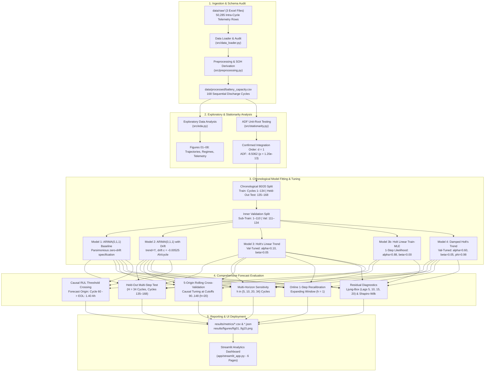
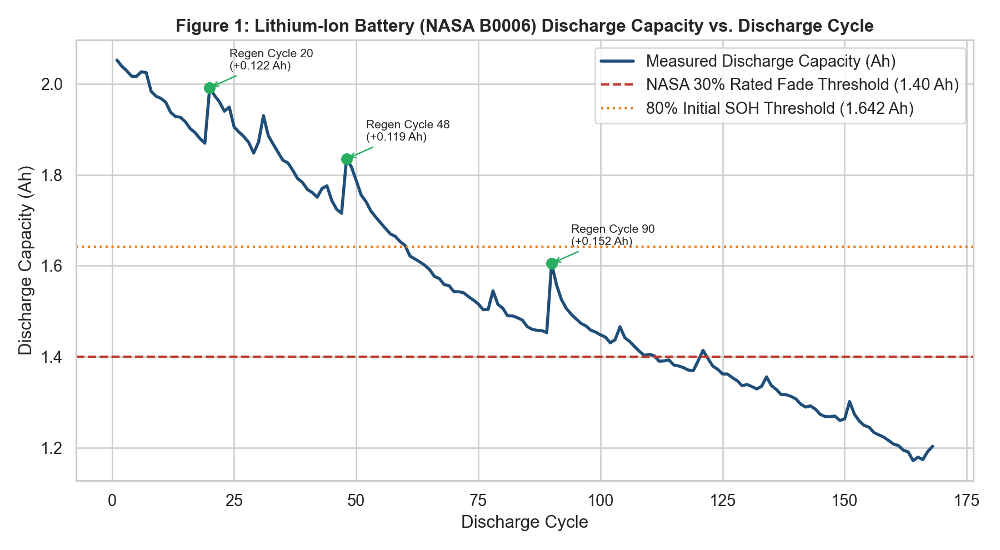
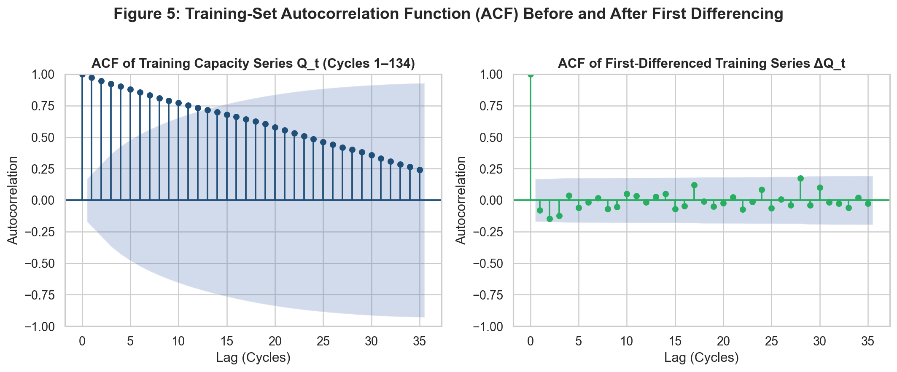
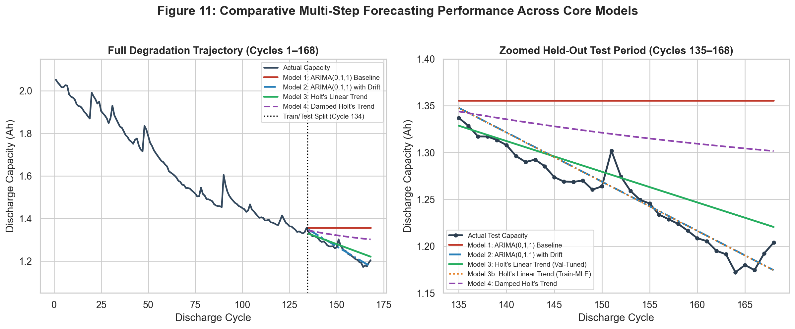
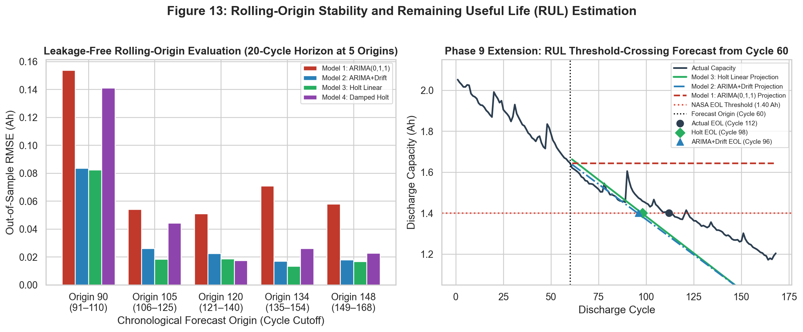
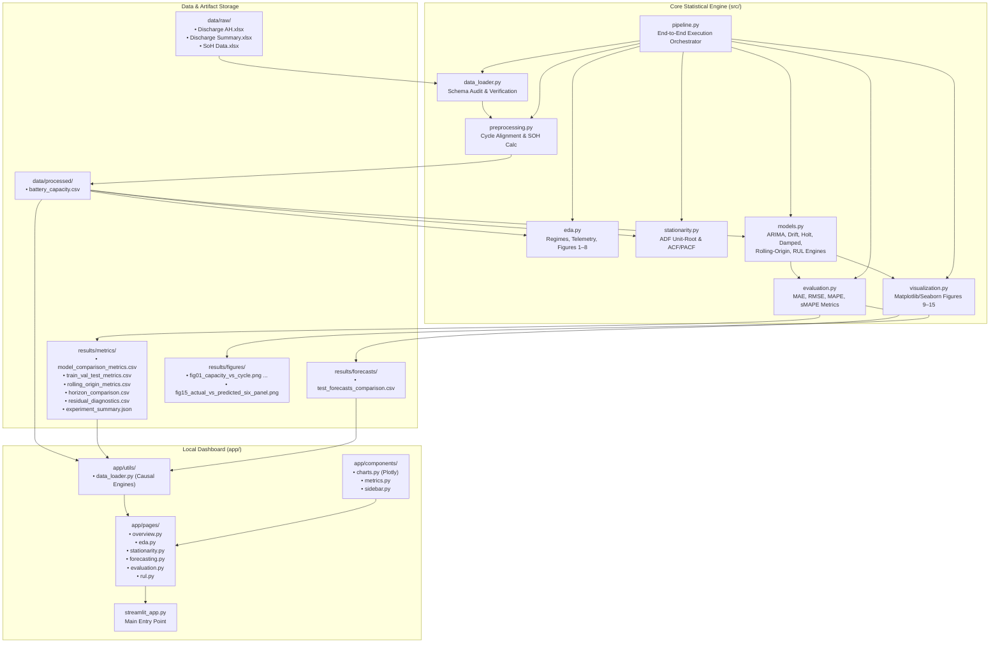

# Before the Battery Dies — Forecasting Lithium-Ion Battery Degradation Using Statistical Time-Series Models

[](https://www.python.org/)
[](https://creativecommons.org/licenses/by/4.0/)
[](https://doi.org/10.17632/7ctkcfnsdw.2)
[](app/streamlit_app.py)

> **An audited, leakage-free statistical forecasting framework benchmarking Box–Jenkins ARIMA and exponential smoothing models on cycle-indexed lithium-ion battery capacity degradation trajectories.**

---

## Quick Navigation

- [1. Project Title and Overview](#1-project-title-and-overview)
- [2. Research Objectives](#2-research-objectives)
- [3. Dataset](#3-dataset)
- [4. Methodology](#4-methodology)
- [5. Forecasting Models](#5-forecasting-models)
- [6. Experimental Design](#6-experimental-design)
- [7. Results and Findings](#7-results-and-findings)
- [8. Interactive Dashboard](#8-interactive-dashboard)
- [9. System Architecture](#9-system-architecture)
- [10. Repository Structure](#10-repository-structure)
- [11. Installation and Setup](#11-installation-and-setup)
- [12. Running the Project](#12-running-the-project)
- [13. Limitations and Future Work](#13-limitations-and-future-work)
- [14. References](#14-references)

---

## 1. Project Title and Overview

### Project Name
**Before the Battery Dies — Forecasting Lithium-Ion Battery Degradation Using Statistical Time-Series Models**  
GitHub Repository: [anya2203/before-the-battery-dies](https://github.com/anya2203/before-the-battery-dies)

### Technical Description
An end-to-end, scientifically audited statistical time-series forecasting framework that extracts cycle-indexed discharge capacity trajectories from experimental lithium-ion aging data, formally tests order-of-integration stationarity, and benchmarks standard Box–Jenkins ARIMA models against trend-aware specifications (ARIMA with Linear Drift, Holt's Linear Trend, and Damped Holt) across multi-step forecast horizons, rolling origins, and Remaining Useful Life (RUL) threshold crossings.

### Motivation
Lithium-ion batteries undergo irreversible electrochemical aging across repeated charge–discharge cycles, driven by solid-electrolyte interphase (SEI) layer growth, loss of lithium inventory (LLI), and loss of active material (LAM). In electric vehicles (EVs) and energy storage systems, this degradation causes capacity fade and range reduction. Standard Battery Management Systems (BMS) monitor current State of Health (SOH) diagnostically, but proactive maintenance and warranty planning require forward-looking *prognostics*—forecasting capacity dozens of cycles ahead before reaching the End-of-Life (EOL) boundary.

### Central Research Question
> **"Can trend-aware statistical forecasting models improve the prediction of lithium-ion battery capacity degradation compared with conventional ARIMA forecasting?"**

### Key Capabilities
- **Cycle-Indexed Formulation:** Indexes observations by sequential discharge cycles ($t = 1 \dots 168$), correctly separating electrochemical cycling usage from wall-clock time intervals.
- **Leakage-Free Protocol:** Audited schema reconciliation ([methodology audit](reports/methodology_audit.md)) ensuring initial capacity normalization ($Q_{\text{initial}} = Q_1$), inner validation parameter tuning, and causal rolling-origin evaluations operate with zero test-set lookahead.
- **Rigorous Stationarity Analysis:** Augmented Dickey–Fuller (ADF) unit-root testing establishing integration order $d = 1$ without over-differencing.
- **Fair Model Benchmarking:** Direct empirical comparison of four core statistical models:
  1. Box–Jenkins ARIMA(0,1,1) Baseline
  2. ARIMA(0,1,1) with Linear Drift (`trend='t'`)
  3. Holt's Linear Trend (Validation-Tuned and Training-MLE variants)
  4. Damped Holt's Trend
- **Multi-Regime Evaluation:** Complete separation of inner validation ($h = 24$), held-out multi-step testing ($H = 34$), rolling-origin cross-validation ($5$ origins, $h = 20$), and online 1-step recalibration ($h = 1$).
- **Residual Diagnostics:** Ljung–Box portmanteau tests across lags $5, 10, 15, 20$ alongside Shapiro–Wilk normality testing to assess white-noise assumptions and rest-recovery impulses.
- **Causal RUL Prognostics:** Threshold-crossing extrapolation to the NASA $1.40\text{ Ah}$ ($70\%$ rated capacity) EOL boundary from Cycle 60.
- **Local Analytics Dashboard:** Six-page Streamlit application ([`app/streamlit_app.py`](app/streamlit_app.py)) for live parameter inspection, causal forecasting, and error visualization.

---

## 2. Research Objectives

1. **Verify Data Provenance and Integrity:** Audit raw multi-spreadsheet telemetry from the Mendeley Data V2 repository (`10.17632/7ctkcfnsdw.2`), confirm single-cell identity (**NASA PCoE Cell B0006** cycled at $24^\circ\text{C}$), resolve experimental operation index multiplexing, and filter cycle-boundary telemetry artifacts.
2. **Formally Determine Integration Order ($d$):** Evaluate the level capacity series ($Q_t$) and differenced series ($\Delta Q_t$) using the Augmented Dickey–Fuller test on training observations to establish whether first-order differencing ($d = 1$) is necessary and sufficient.
3. **Investigate the Role of Explicit Trend Terms:** Determine why standard difference-stationary $\text{ARIMA}(p,1,q)$ models plateau over multi-step horizons, and quantify the error reduction achieved by incorporating a deterministic drift parameter ($c$) or adaptive local slope state ($T_t$).
4. **Quantify Multi-Horizon Error Growth:** Measure the scaling of Mean Absolute Error (MAE), Root Mean Squared Error (RMSE), Mean Absolute Percentage Error (MAPE), and Symmetric Mean Absolute Percentage Error (sMAPE) across short ($h = 5, 10$), medium ($h = 20$), and long ($h = 34$) cycle horizons.
5. **Assess Temporal Stability via Rolling Origins:** Execute leakage-free rolling-origin cross-validation across five chronological origins ($t_{\text{origin}} \in \{90, 105, 120, 134, 148\}$) with causal parameter re-estimation to evaluate stability across distinct degradation regimes.
6. **Evaluate Residual Properties and Innovation Assumptions:** Test whether model residuals conform to white noise via Ljung–Box tests across multiple lag orders, examining the statistical impact of discrete rest-induced capacity regeneration spikes.
7. **Demonstrate Practical Prognostic Utility (RUL):** Evaluate causal Remaining Useful Life threshold-crossing estimation from mid-life (Cycle 60) to the NASA experimental EOL threshold ($1.40\text{ Ah}$).

---

## 3. Dataset

### Experimental Provenance
The experimental data originates from the **NASA Ames Prognostics Center of Excellence (PCoE) Lithium-Ion Battery Aging Dataset** (Saha & Goebel, 2007), curated in the **EV Lithium Ion Battery State of Health Dataset (Mendeley Data V2)** by Venkataramana Veeramsetty and Keerthi Sri G.V. (2026), DOI: [`10.17632/7ctkcfnsdw.2`](https://doi.org/10.17632/7ctkcfnsdw.2), licensed under CC BY 4.0.

### Cell Characteristics and Cycling Protocol
- **Cell Identifier:** NASA PCoE Cell **B0006**
- **Form Factor & Chemistry:** Commercial 18650 cylindrical cell, Lithium Cobalt Oxide ($\text{LiCoO}_2$) cathode, graphite anode.
- **Nominal Rated Capacity:** $2.000\text{ Ah}$
- **Thermal Environment:** Cycled inside an isothermal chamber at a constant ambient temperature of **$24.0^\circ\text{C}$** ($\text{SD} = 0.0^\circ\text{C}$ across all $50,285$ telemetry rows). Ambient temperature has zero variance and cannot serve as an explanatory covariate.
- **Charging Protocol:** Constant Current / Constant Voltage (CC-CV) mode at $1.5\text{ A}$ to $4.2\text{ V}$, tapering until current fell to $20\text{ mA}$.
- **Discharge Protocol:** Constant current discharge at $2.0\text{ A}$ ($1.0\text{ C}$ rate) until terminal voltage dropped to $2.5\text{ V}$.

### Capacity and SOH Summary Statistics
| Metric | Value | Verification Source |
| :--- | :--- | :--- |
| Total Discharge Cycles ($N$) | **$168$** sequential cycles | `data/processed/battery_capacity.csv` |
| Intra-Cycle Telemetry Measurements | **$50,285$** time steps | `data/raw/Discharge AH.xlsx` |
| Initial Discharge Capacity ($Q_1$) | **$2.051974\text{ Ah}$** | Cycle 1 discharge capacity ($100.00\%\text{ SOH}$) |
| Nominal Rated Capacity ($Q_{\text{rated}}$) | **$2.000000\text{ Ah}$** | Initial rated SOH: $102.60\%$ |
| Minimum Capacity ($Q_{164}$) | **$1.172108\text{ Ah}$** | Minimum observed capacity ($57.12\%\text{ SOH}$) |
| Final Capacity ($Q_{168}$) | **$1.203769\text{ Ah}$** | End-of-test capacity ($58.66\%\text{ SOH}$) |
| Peak Cumulative Capacity Fade | **$0.879866\text{ Ah}$** ($42.88\%$) | Cycle 164 maximum capacity loss |
| NASA EOL Threshold ($1.40\text{ Ah}$) | **Cycle 112** | $70\%$ of nominal rating ($30\%$ fade) |

> [!IMPORTANT]
> **Cycle-Based vs. Calendar-Time Indexing:**  
> The time-series index represents successive **discharge cycle numbers** ($t = 1, \dots, 168$), not uniform calendar-time intervals. Operational rest pauses between discharge runs vary from hours to weeks. Forecasts and RUL estimates are therefore strictly expressed in **cycles**, which directly reflect electrochemical battery usage.

### Preprocessing Considerations
Our data audit ([data inspection report](reports/data_inspection.md) and [methodology audit](reports/methodology_audit.md)) established four critical preprocessing rules implemented in [`src/preprocessing.py`](src/preprocessing.py):
1. **Single-Cell Verification:** Cross-referencing `Discharge AH.xlsx` ($50,285$ rows), `Discharge Summary.xlsx` ($168$ rows), and `SoH Data.xlsx` ($168$ rows) verified that all records correspond exclusively to Cell B0006. No multi-cell concatenation is performed.
2. **Operation Counter Disambiguation:** In the NASA test bed, charge cycles, discharge cycles, and impedance tests share a single global counter (`2` to `614`). We retain `operation_cycle_id` for provenance while indexing our time series strictly by sequential discharge cycle `cycle_number` ($t \in \{1, 2, \dots, 168\}$).
3. **Telemetry Boundary Filtering:** In `Discharge AH.xlsx`, row-to-row diffs across cycle transitions generated $167$ negative $\Delta t$ artifacts. Preprocessing groups telemetry strictly by cycle boundary, deriving valid cycle duration, voltage extrema, and mean currents.
4. **Leakage-Free Health Indicators:** State of Health is computed relative to the first training observation:
   $$\text{SOH}_t (\%) = \frac{Q_t}{Q_1} \times 100, \quad Q_{\text{initial}} = Q_1 = 2.051974\text{ Ah}.$$
   The clean output is exported to [`data/processed/battery_capacity.csv`](data/processed/battery_capacity.csv) ($168\text{ rows} \times 14\text{ columns}$).

---

## 4. Methodology

The complete research workflow follows a sequential, leakage-free pipeline from raw spreadsheet ingestion to causal prognostics:



---

## 5. Forecasting Models

### Model 1 — Box–Jenkins Baseline: ARIMA(0, 1, 1) without Drift
Standard difference-stationary autoregressive integrated moving average model operating on first-differenced capacity $\Delta Q_t = Q_t - Q_{t-1}$:
$$\Delta Q_t = \varepsilon_t + \theta_1 \varepsilon_{t-1}, \quad \varepsilon_t \sim \mathcal{WN}(0, \sigma^2)$$
- **Fitted Parameters:** $\theta_1 = -0.1179$, $\sigma^2 = 0.000650$, $\text{AIC} = -593.50$, $\text{BIC} = -587.72$.
- **Multi-Step Behavior:** Because the difference equation has no constant term, $\mathbb{E}[\Delta Q_{n+h}] = 0$ for $h \ge 2$. Over an open-loop multi-step horizon, forecasts plateau immediately:
  $$\hat{Q}_{n+h|n} = \hat{Q}_{n+1|n} = 1.3552\text{ Ah}, \quad \forall h \ge 2.$$
  This flat projection causes monotonically growing error as actual battery capacity continues to decline.

### Model 2 — Trend-Aware ARIMA: ARIMA(0, 1, 1) with Linear Drift
Incorporates a deterministic per-cycle drift parameter $c$ into the difference equation (`trend='t'` in `statsmodels`):
$$\Delta Q_t = c + \varepsilon_t + \theta_1 \varepsilon_{t-1}$$
- **Fitted Parameters:** Estimated drift rate $c = -0.005251\text{ Ah/cycle}$, $\theta_1 = -0.1178$, $\sigma^2 = 0.000623$, $\text{AIC} = -598.25$, $\text{BIC} = -589.57$.
- **Multi-Step Behavior:** Propagates the persistent downward degradation slope over the entire forecast horizon:
  $$\hat{Q}_{n+h|n} = \hat{Q}_{n+1|n} + (h - 1)c.$$

### Model 3 — Holt's Linear Trend (Double Exponential Smoothing)
Decomposes the non-stationary series into an adaptive local capacity level $L_t$ and degradation trend slope $T_t$:
$$\begin{aligned}
\text{Level Update:} \quad L_t &= \alpha Q_t + (1 - \alpha)(L_{t-1} + T_{t-1}), \quad 0 < \alpha \le 1 \\
\text{Trend Update:} \quad T_t &= \beta (L_t - L_{t-1}) + (1 - \beta) T_{t-1}, \quad 0 \le \beta \le 1 \\
\text{$h$-Step Forecast:} \quad \hat{Q}_{n+h|n} &= L_n + h T_n
\end{aligned}$$

We evaluate two distinct, carefully documented parameterizations:
1. **Model 3 (Validation-Tuned — Primary Enhanced Model):**
   - **Hyperparameters:** $\alpha = 0.10, \beta = 0.05$, selected by minimizing 24-step out-of-sample forecast RMSE on the inner validation window (Cycles 111–134, $\text{RMSE} = 0.01732\text{ Ah}$).
   - **State at Origin (Cycle 134):** $L_{134} = 1.3318\text{ Ah}$, local slope $T_{134} = -0.003275\text{ Ah/cycle}$ ($\text{AIC} = -887.95$).
   - **Rationale:** Low $\alpha = 0.10$ provides heavy smoothing that filters out discrete rest-regeneration spikes, while $\beta = 0.05$ adapts to the deceleration observed between Cycles 91 and 134.
2. **Model 3b (Training-MLE — Diagnostic Variant):**
   - **Hyperparameters:** $\alpha = 0.8756, \beta = 0.0000$, fitted by maximizing 1-step-ahead Gaussian likelihood ($\text{SSE} = 0.08284\text{ Ah}^2$, $\text{AIC} = -982.08$).
   - **State at Origin (Cycle 134):** $L_{134} = 1.3547\text{ Ah}$, global slope $T_{134} \equiv T_0 = -0.005249\text{ Ah/cycle}$.
   - **Mathematical Equivalence:** When $\beta \to 0$ and $\alpha \approx 1 + \theta_1 = 0.8822$, Holt's linear trend becomes mathematically equivalent to $\text{ARIMA}(0,1,1)$ with constant drift.

### Model 4 — Damped Holt's Trend
Introduces an autoregressive damping parameter $\phi \in (0, 1)$ that progressively attenuates the degradation slope into the future:
$$\begin{aligned}
L_t &= \alpha Q_t + (1 - \alpha)(L_{t-1} + \phi T_{t-1}) \\
T_t &= \beta (L_t - L_{t-1}) + (1 - \beta)\phi T_{t-1} \\
\hat{Q}_{n+h|n} &= L_n + \left(\sum_{j=1}^h \phi^j\right) T_n
\end{aligned}$$
- **Hyperparameters:** $\alpha = 0.60, \beta = 0.05, \phi = 0.98$, selected via inner validation grid search ($\text{val\_rmse} = 0.01375\text{ Ah}$, the lowest single validation RMSE among all candidate models; refit training $\text{AIC} = -968.77$).

---

## 6. Experimental Design

### Chronological Splitting Protocol
To ensure strict temporal causality with zero lookahead bias, all data splitting respects chronological sequence:
- **Outer Training Set:** Cycles $1\text{–}134$ ($134$ observations, $79.8\%$ of data). Capacity declines from $2.0520\text{ Ah}$ to $1.3547\text{ Ah}$.
- **Inner Validation Split:** Sub-training on Cycles $1\text{–}110$; out-of-sample validation on Cycles $111\text{–}134$ ($24$ observations, $h = 24$). Used exclusively for candidate order screening and exponential smoothing hyperparameter grid search.
- **Held-Out Test Set:** Cycles $135\text{–}168$ ($34$ observations, $20.2\%$ of data, $H = 34$ cycles). Capacity declines from $1.3369\text{ Ah}$ to $1.2038\text{ Ah}$ (reaching minimum $1.1721\text{ Ah}$ at Cycle 164). This set was locked and untouched during model development.

### Four Distinct Evaluation Regimes
It is vital not to conflate different evaluation regimes:
1. **Inner Validation ($h = 24$):** Out-of-sample multi-step evaluation on Cycles 111–134 using models trained only on Cycles 1–110. Used for model selection.
2. **Held-Out Multi-Step Testing ($H = 34$):** Open-loop forecast from Cycle 134 across Cycles 135–168 where no test labels are fed back.
3. **Rolling-Origin Cross-Validation ($h = 20$):** Five chronological forecast origins ($t_{\text{origin}} \in \{90, 105, 120, 134, 148\}$). At each cutoff, models are re-tuned and refitted using only data up to $t_{\text{origin}}$, forecasting the subsequent $20$ cycles.
4. **Online 1-Step Recalibration ($h = 1$):** Sequential expanding-window updates across Cycles 135–168, providing true cycle-by-cycle BMS operational tracking.

### Evaluation Metrics
Given true capacities $Q_{n+h}$ and forecasts $\hat{Q}_{n+h}$ for $h \in \{1, \dots, H\}$:

$$\text{MAE} = \frac{1}{H}\sum_{h=1}^H |Q_{n+h} - \hat{Q}_{n+h}|, \quad \text{RMSE} = \sqrt{\frac{1}{H}\sum_{h=1}^H (Q_{n+h} - \hat{Q}_{n+h})^2}$$

$$\text{MAPE} = \frac{100}{H}\sum_{h=1}^H \left|\frac{Q_{n+h} - \hat{Q}_{n+h}}{Q_{n+h}}\right|, \quad \text{sMAPE} = \frac{100}{H}\sum_{h=1}^H \frac{2|Q_{n+h} - \hat{Q}_{n+h}|}{|Q_{n+h}| + |\hat{Q}_{n+h}|}$$

- **Physical Meaning in Ah:** For a nominal $2.0\text{ Ah}$ cell, an MAE of $0.020\text{ Ah}$ corresponds to an average charge prediction error of $1.0\%$ of rated capacity. RMSE penalizes larger deviations quadratically.
- **Why sMAPE is Included:** Standard MAPE divides by true capacity $Q_{n+h}$. As a battery ages toward EOL ($Q \to 1.20\text{ Ah}$), identical absolute errors produce inflated percentage penalties, and MAPE penalizes over-forecasts ($\hat{Q} > Q$) more heavily than under-forecasts. Symmetric MAPE normalizes by the average of actual and predicted values, providing an unbiased relative scale. For extended mathematical derivations, see the [project technical report](reports/project_report.md).

---

## 7. Results and Findings

### 7.1 Headline Model Comparison on Held-Out Test Set (Cycles 135–168, $H = 34$)
The table below reports performance across Training (1-step in-sample), Inner Validation (24-step out-of-sample), and Held-Out Test (34-step out-of-sample) sets (`results/metrics/model_comparison_metrics.csv` and `results/metrics/train_val_test_metrics.csv`).

| Model Specification | Train RMSE (Ah)<br/>[1-Step, C1–134] | Val RMSE (Ah)<br/>[24-Step, C111–134] | Test MAE (Ah)<br/>[34-Step, C135–168] | Test RMSE (Ah)<br/>[34-Step, C135–168] | Test MAPE (%) | Test sMAPE (%) | RMSE vs.<br/>Baseline |
| :--- | :---: | :---: | :---: | :---: | :---: | :---: | :---: |
| **Model 1: ARIMA(0, 1, 1) — Baseline** | 0.02560 | 0.04286 | 0.10094 | 0.11153 | 8.203% | 7.805% | — |
| **Model 2: ARIMA(0, 1, 1) with Drift** | 0.02496 | 0.04689 | **0.01298** | **0.01522** | **1.030%** | **1.028%** | **−86.4%** |
| **Model 3: Holt Linear (Val-Tuned: $\alpha=0.10, \beta=0.05$)** | 0.03533 | 0.01732 | **0.02253** | **0.02739** | **1.841%** | **1.817%** | **−75.4%** |
| **Model 3b: Holt Linear (Train-MLE: $\alpha=0.88, \beta=0.00$)** | 0.02486 | 0.04683 | **0.01288** | **0.01514** | **1.022%** | **1.020%** | **−86.4%** |
| **Model 4: Damped Holt (Val-Tuned: $\alpha=0.60, \beta=0.05, \phi=0.98$)** | 0.02594 | **0.01375** | 0.06616 | 0.07513 | 5.390% | 5.205% | −32.6% |

> [!NOTE]
> **Candidate ARIMA Order Selection Note:**  
> Candidate ARIMA order grid search results (e.g. ARIMA(1,1,1) and ARIMA(2,1,1)) in `results/metrics/arima_order_selection.csv` exhibit minor numerical sensitivity across computing environments due to solver convergence tolerances in `statsmodels`. Consequently, candidate grid search rows are excluded from headline findings. ARIMA(0,1,1) is retained as the parsimonious baseline supported by Akaike Information Criterion ($\text{AIC} = -593.50$).

### 7.2 Leakage-Free Rolling-Origin Cross-Validation ($5$ Origins, $h = 20$ Cycles)
To test stability across distinct aging phases, all models were evaluated across five chronological origins with causal re-tuning (`results/metrics/rolling_origin_metrics.csv`):

| Model | Origins Evaluated | Mean MAE ± SD (Ah) | Mean RMSE ± SD (Ah) | Mean MAPE ± SD (%) | Mean sMAPE ± SD (%) |
| :--- | :---: | :---: | :---: | :---: | :---: |
| **Model 1: ARIMA(0, 1, 1) Baseline** | 90, 105, 120, 134, 148 | $0.07231 \pm 0.04333$ | $0.07753 \pm 0.04322$ | $5.341\% \pm 2.833\%$ | $5.152\% \pm 2.636\%$ |
| **Model 2: ARIMA(0, 1, 1) with Drift** | 90, 105, 120, 134, 148 | $0.02920 \pm 0.02955$ | $0.03337 \pm 0.02826$ | $2.097\% \pm 1.985\%$ | $2.072\% \pm 1.909\%$ |
| **Model 3: Holt Linear (Causally Tuned)** | 90, 105, 120, 134, 148 | **$0.02699 \pm 0.03028$** | **$0.02992 \pm 0.02943$** | **$1.924\% \pm 2.032\%$** | **$1.959\% \pm 2.104\%$** |
| **Model 4: Damped Holt (Causally Tuned)** | 90, 105, 120, 134, 148 | $0.04538 \pm 0.04800$ | $0.05030 \pm 0.05162$ | $3.275\% \pm 3.261\%$ | $3.167\% \pm 3.067\%$ |

Across the five rolling origins, **Holt's Linear Trend** achieved the lowest mean rolling-origin RMSE ($0.02992\text{ Ah}$) and lowest mean MAPE ($1.924\%$), closely followed by **ARIMA(0,1,1) with Drift** ($0.03337\text{ Ah}$, $2.097\%$). Both trend-aware models cut average forecast error by more than $57\%$ compared to baseline ARIMA(0,1,1) ($0.07753\text{ Ah}$).

### 7.3 Multi-Horizon Error Scaling ($h = 5, 10, 20, 34$ Cycles)
Tracking forecast error from Origin Cycle 134 as the horizon expands (`results/metrics/horizon_comparison.csv`):

| Horizon ($h$) | Test Window | Model 1: ARIMA(0,1,1)<br/>RMSE (MAPE / sMAPE) | Model 2: ARIMA+Drift<br/>RMSE (MAPE / sMAPE) | Model 3: Holt Val-Tuned<br/>RMSE (MAPE / sMAPE) | Model 3b: Holt Train-MLE<br/>RMSE (MAPE / sMAPE) | Model 4: Damped Holt<br/>RMSE (MAPE / sMAPE) |
| :---: | :---: | :---: | :---: | :---: | :---: | :---: |
| **$h = 5$** | C135–139 | $0.03377\text{ Ah}$ ($2.47\% / 2.44\%$) | $0.01485\text{ Ah}$ ($1.10\% / 1.09\%$) | **$0.00472\text{ Ah}$ ($0.31\% / 0.31\%$)** | $0.01467\text{ Ah}$ ($1.09\% / 1.08\%$) | $0.01898\text{ Ah}$ ($1.35\% / 1.34\%$) |
| **$h = 10$** | C135–144 | $0.04952\text{ Ah}$ ($3.59\% / 3.52\%$) | $0.01589\text{ Ah}$ ($1.19\% / 1.18\%$) | **$0.00910\text{ Ah}$ ($0.59\% / 0.59\%$)** | $0.01572\text{ Ah}$ ($1.18\% / 1.17\%$) | $0.03035\text{ Ah}$ ($2.15\% / 2.12\%$) |
| **$h = 20$** | C135–154 | $0.07092\text{ Ah}$ ($5.20\% / 5.05\%$) | $0.01692\text{ Ah}$ ($1.17\% / 1.17\%$) | **$0.01477\text{ Ah}$ ($0.98\% / 0.98\%$)** | $0.01682\text{ Ah}$ ($1.17\% / 1.16\%$) | $0.04407\text{ Ah}$ ($3.16\% / 3.10\%$) |
| **$h = 34$** | C135–168 | $0.11153\text{ Ah}$ ($8.20\% / 7.81\%$) | $0.01522\text{ Ah}$ ($1.03\% / 1.03\%$) | $0.02739\text{ Ah}$ ($1.84\% / 1.82\%$) | **$0.01514\text{ Ah}$ ($1.02\% / 1.02\%$)** | $0.07513\text{ Ah}$ ($5.39\% / 5.21\%$) |

- **Short-to-Medium Horizons ($h \le 20$):** Validation-Tuned Holt Linear is the most accurate model, keeping MAPE below $1.0\%$ through 20 cycles ahead ($0.306\%$ at $h=5$, $0.591\%$ at $h=10$, $0.983\%$ at $h=20$).
- **Long Horizon ($h = 34$):** Late-life degradation accelerated between Cycles 152 and 164 ($-0.0057\text{ Ah/cycle}$), matching the global training slope ($-0.00525\text{ Ah/cycle}$). Consequently, ARIMA with Drift and Train-MLE Holt achieved lower 34-cycle test RMSE ($0.0152\text{ Ah}$ and $0.0151\text{ Ah}$).

### 7.4 Online One-Step Recalibration ($h = 1$, Cycles 135–168)
When a BMS ingests single-cycle updates in real time (`results/metrics/online_recalibration_metrics.csv`):

| Model (Expanding Window Online Updates) | Horizon | Steps | MAE (Ah) | RMSE (Ah) | MAPE (%) | sMAPE (%) |
| :--- | :---: | :---: | :---: | :---: | :---: | :---: |
| **Online 1-Step ARIMA(0, 1, 1) Baseline** | $h = 1$ | 34 | 0.00950 | 0.01218 | 0.757% | 0.756% |
| **Online 1-Step ARIMA(0, 1, 1) with Drift** | $h = 1$ | 34 | **0.00723** | **0.01125** | **0.577%** | **0.579%** |
| **Online 1-Step Holt's Linear Trend** | $h = 1$ | 34 | 0.01236 | 0.01482 | 0.998% | 0.996% |

With 1-step recalibration, all models achieve sub-$1\%$ MAPE, demonstrating that open-loop multi-step divergence is primarily caused by horizon accumulation of unmodeled slope rather than high 1-step noise.

### 7.5 Residual Diagnostics & White-Noise Hypothesis Testing
Training residual properties across all models (`results/metrics/residual_diagnostics.csv`):

| Model | $N$ | Mean (Ah) | SD (Ah) | Skew / Kurt | Ljung–Box $Q$ ($p$)<br/>Lag 5 | Ljung–Box $Q$ ($p$)<br/>Lag 10 | Ljung–Box $Q$ ($p$)<br/>Lag 20 | Shapiro–Wilk<br/>$W$ ($p$) | Decision ($\alpha=0.05$) |
| :--- | :---: | :---: | :---: | :---: | :---: | :---: | :---: | :---: | :--- |
| **Model 1: ARIMA(0,1,1)** | 133 | $-0.00547$ | 0.02510 | $3.86 / 19.04$ | $6.36$ ($0.273$) | $8.01$ ($0.628$) | $12.36$ ($0.903$) | $0.604$ ($2.3\times 10^{-17}$) | Fail to reject $H_0$ |
| **Model 2: ARIMA(0,1,1)+Drift** | 133 | $-0.00001$ | 0.02505 | $3.91 / 19.13$ | $6.71$ ($0.243$) | $8.44$ ($0.586$) | $12.66$ ($0.891$) | $0.602$ ($2.1\times 10^{-17}$) | Fail to reject $H_0$ |
| **Model 3: Holt Linear ($\alpha=0.10, \beta=0.05$)** | 134 | $+0.00788$ | 0.03457 | $1.90 / 4.90$ | $125.45$ ($2.2\times 10^{-25}$) | $127.47$ ($1.5\times 10^{-22}$) | $144.05$ ($8.6\times 10^{-21}$) | $0.838$ ($7.9\times 10^{-11}$) | **Reject $H_0$** (Autocorrelated) |
| **Model 3b: Holt Linear MLE ($\alpha=0.88, \beta=0.00$)** | 134 | $-0.00000$ | 0.02496 | $3.92 / 19.29$ | $6.83$ ($0.234$) | $8.58$ ($0.573$) | $12.78$ ($0.887$) | $0.601$ ($1.7\times 10^{-17}$) | Fail to reject $H_0$ |
| **Model 4: Damped Holt ($\alpha=0.60, \beta=0.05, \phi=0.98$)** | 134 | $-0.00138$ | 0.02600 | $3.59 / 16.51$ | $15.90$ ($0.007$) | $19.59$ ($0.033$) | $23.30$ ($0.274$) | $0.645$ ($1.5\times 10^{-16}$) | **Reject $H_0$** (Lags 5, 10) |

> [!WARNING]
> **Statistical Interpretation of Residual White Noise:**
> 1. **Failing to reject $H_0$ does not prove white noise:** For Models 1, 2, and 3b, high Ljung–Box $p$-values ($p > 0.20$) mean we fail to reject the null hypothesis of zero autocorrelation up to lag 20. This indicates uncorrelated residuals, but white noise is not formally proven.
> 2. **Non-Normality is Decisive:** All models reject Gaussianity under Shapiro–Wilk ($p < 10^{-10}$) due to heavy positive skewness ($1.90\text{–}3.92$) and leptokurtosis ($4.90\text{–}19.29$) caused by discrete rest-regeneration spikes (e.g. $+0.152\text{ Ah}$ at Cycle 90).
> 3. **Validation-Tuned Holt's 1-Step Residual Trade-Off:** Model 3 deliberately sets low $\alpha = 0.10$ to smooth out regeneration jumps and stabilize multi-step trajectory slope. This trades 1-step in-sample fit for out-of-sample multi-step stability, leaving positive serial correlation in 1-step training residuals.

### 7.6 Remaining Useful Life (RUL) Estimation from Cycle 60
Evaluating causal EOL threshold-crossing prediction from Origin Cycle 60 ($Q_{60} = 1.6447\text{ Ah}$) to the NASA $1.40\text{ Ah}$ threshold (actual EOL at **Cycle 112**, true $\text{RUL} = 52$ cycles):
- **Model 1 (ARIMA Baseline):** Projects a horizontal asymptote at $1.643\text{ Ah}$ and **never crosses $1.40\text{ Ah}$** ($\text{Predicted RUL} = \text{None}$), failing completely as a prognostic tool.
- **Model 2 (ARIMA with Drift):** Predicts EOL at **Cycle 96** ($\text{Predicted RUL} = 36$ cycles, error $= -16$ cycles).
- **Model 3 (Causally Tuned Holt Linear):** Predicts EOL at **Cycle 98** ($\text{Predicted RUL} = 38$ cycles, error $= -14$ cycles).
- **Physical Interpretation:** The conservative $-14$ to $-16$ cycle early prediction error is directly explained by the unexpected $+0.1518\text{ Ah}$ capacity regeneration jump at Cycle 90, which temporarily extended physical cell life by roughly a dozen cycles.

### 7.7 What the Results Prove vs. What They Do Not Prove
- **What they prove:** Explicit trend modeling (ARIMA with Drift or Holt's Linear Trend) is essential for multi-step battery capacity forecasting. On Cell B0006, it reduces 34-cycle out-of-sample RMSE by $75.4\%$ to $86.4\%$ compared to un-drifted ARIMA(0,1,1), and maintains an error advantage across all horizons ($h=5\dots 34$) and all five rolling origins.
- **What they do not prove:** No single model is universally superior. Damped Holt achieved the lowest single validation RMSE ($0.01375\text{ Ah}$); Holt Linear achieved the lowest mean rolling-origin RMSE ($0.02992\text{ Ah}$) and lowest short-horizon test error; and ARIMA with Drift achieved the lowest 34-cycle test RMSE ($0.01522\text{ Ah}$). Furthermore, single-cell linear statistical extrapolation cannot be assumed to generalize across different battery chemistries or sudden late-life nonlinear "knee" collapse.

---

## 8. Interactive Dashboard

The repository includes a six-page local analytics application built with **Streamlit** and **Plotly** ([`app/streamlit_app.py`](app/streamlit_app.py)), structured for modular battery prognostics analysis:

1. **Overview ([`app/pages/overview.py`](app/pages/overview.py)):** Executive KPI cards for NASA Cell B0006 ($168$ cycles, $2.052\text{ Ah}$ initial, $1.172\text{ Ah}$ minimum, $57.12\%$ min SOH), interactive capacity and SOH degradation plots with chronological train/test split boundary, dataset audit summary, and searchable data table.
2. **Exploratory Data Analysis ([`app/pages/eda.py`](app/pages/eda.py)):** Interactive tabs for cycle-to-cycle capacity differences ($\Delta Q_t$) highlighting rest-regeneration spikes, 10-cycle rolling mean and volatility envelopes, regime-stratified capacity distributions, and training-set ACF/PACF plots.
3. **Stationarity Analysis ([`app/pages/stationarity.py`](app/pages/stationarity.py)):** Visual comparison of level ($d=0$) vs. first-differenced ($d=1$) capacity series with exact ADF test statistics, critical values, and mathematical justification for integration order $d=1$.
4. **Forecasting Lab ([`app/pages/forecasting.py`](app/pages/forecasting.py)):** Live model workbench allowing users to select any forecast origin ($50\dots 158$) and horizon ($5\dots 60$ cycles), fit candidate models strictly causally, and inspect predicted trajectories with $95\%$ confidence intervals.
5. **Model Evaluation ([`app/pages/evaluation.py`](app/pages/evaluation.py)):** Interactive multi-metric leaderboard, horizon decay curves ($h = 1\dots 34$), 5-origin rolling cross-validation bars, online 1-step filtering comparison, and full Ljung–Box residual diagnostics.
6. **Remaining Useful Life ([`app/pages/rul.py`](app/pages/rul.py)):** Configurable EOL capacity threshold slider ($1.20\dots 1.60\text{ Ah}$) and forecast origin selector, displaying predicted crossing cycles, actual observed RUL, and engineering interpretation.

### Key Visualizations from the Research Pipeline

The figures below represent actual artifacts generated by `src/visualization.py` in `results/figures/`:

#### 1. Full Capacity Degradation Trajectory & Rest-Induced Regeneration Spikes

*Figure 1: Measured discharge capacity ($Q_t$ in Ah) across all 168 cycles for NASA Cell B0006 at $24^\circ\text{C}$, illustrating overall degradation punctuated by rest-recovery capacity jumps at Cycles 20, 48, 90, and 151 (`results/figures/fig01_capacity_vs_cycle.png`).*

#### 2. Autocorrelation Function (ACF) Diagnostics & Integration Order ($d=1$)

*Figure 2: Autocorrelation Function computed strictly on the 134-cycle training sequence. The slow linear decay in levels ($d=0$) confirms non-stationarity, while first differencing ($d=1$) removes the stochastic trend (`results/figures/fig05_acf_plot.png`).*

#### 3. Core Forecasting Model Comparison on Held-Out Test Period

*Figure 3: Comparative multi-step forecasts across the 34 held-out test cycles (Cycles 135–168). Left: Full 168-cycle trajectory context. Right: Zoomed test period comparing un-drifted ARIMA baseline plateau against trend-aware models (`results/figures/fig11_model_comparison_forecasts.png`).*

#### 4. Rolling-Origin Cross-Validation & Causal RUL Estimation

*Figure 4: Left: Out-of-sample RMSE across 5 chronological rolling origins ($h=20$). Right: Causal Remaining Useful Life threshold-crossing projection from Cycle 60 toward the NASA $1.40\text{ Ah}$ EOL boundary (`results/figures/fig13_rolling_origin_and_rul.png`).*

---

## 9. System Architecture

The repository architecture cleanly decouples raw data ingestion, statistical modeling, artifact persistence, and interactive visualization:



---

## 10. Repository Structure

```text
before-the-battery-dies/
├── .streamlit/
│   └── config.toml                        # Dashboard theme & server configuration
├── app/                                   # Local Streamlit analytics application
│   ├── streamlit_app.py                   # Multi-page dashboard runner
│   ├── components/                        # UI cards, Plotly charts, and navigation sidebar
│   │   ├── charts.py
│   │   ├── metrics.py
│   │   └── sidebar.py
│   ├── pages/                             # Six analytical dashboard pages
│   │   ├── overview.py
│   │   ├── eda.py
│   │   ├── stationarity.py
│   │   ├── forecasting.py
│   │   ├── evaluation.py
│   │   └── rul.py
│   └── utils/                             # Causal data and model loading utilities
│       └── data_loader.py
├── data/
│   ├── raw/                               # Raw Mendeley V2 / NASA B0006 Excel files
│   │   ├── Discharge AH.xlsx
│   │   ├── Discharge Summary.xlsx
│   │   └── SoH Data.xlsx
│   └── processed/                         # Audited cycle-indexed time-series dataset
│       └── battery_capacity.csv
├── notebooks/
│   └── battery_degradation_analysis.ipynb # Interactive research & replication notebook
├── reports/                               # Comprehensive technical and methodology reports
│   ├── data_inspection.md                 # Detailed raw schema audit
│   ├── final_validation_checklist.md      # Validation audit checklist
│   ├── methodology_audit.md               # Scientific lookahead & leakage audit
│   ├── project_report.md                  # Comprehensive academic research report
│   └── technical_blog.md                  # Engineering and domain article
├── research/
│   └── literature_review.md               # 7-paper reviewed literature survey & synthesis
├── results/
│   ├── figures/                           # 15 publication-grade visualization artifacts
│   │   ├── fig01_capacity_vs_cycle.png ... fig13_rolling_origin_and_rul.png
│   │   ├── fig14_comprehensive_residual_diagnostics.png
│   │   └── fig15_actual_vs_predicted_six_panel.png
│   ├── forecasts/                         # Cycle-by-cycle held-out model predictions
│   │   └── test_forecasts_comparison.csv
│   └── metrics/                           # Evaluated experimental metrics and summaries
│       ├── arima_order_selection.csv
│       ├── experiment_summary.json
│       ├── holt_parameter_tuning.csv
│       ├── horizon_comparison.csv
│       ├── model_comparison_metrics.csv
│       ├── online_recalibration_metrics.csv
│       ├── residual_diagnostics.csv
│       ├── rolling_origin_evaluation.csv
│       ├── rolling_origin_metrics.csv
│       ├── stationarity_results.json
│       └── train_val_test_metrics.csv
├── src/                                   # Core statistical time-series Python library
│   ├── data_loader.py                     # Excel loader & schema verification
│   ├── eda.py                             # Exploratory data analysis & Figures 1–8
│   ├── evaluation.py                      # Metrics calculation & benchmark reporting
│   ├── models.py                          # ARIMA, Drift, Holt, Damped, Rolling & RUL
│   ├── pipeline.py                        # Automated end-to-end pipeline runner
│   ├── preprocessing.py                   # Sequential cycle alignment & SOH derivation
│   ├── stationarity.py                    # ADF unit-root tests & differencing
│   └── visualization.py                   # Matplotlib/Seaborn diagnostic Figures 9–15
├── tests/                                 # Automated test suite
│   ├── test_frontend.py                   # Frontend UI and Plotly builder tests
│   └── test_preprocessing.py              # Preprocessing, splitting, and metric tests
├── .gitignore                             # Git exclusion patterns
├── README.md                              # This research and engineering documentation
└── requirements.txt                       # Python dependency specifications
```

---

## 11. Installation and Setup

### Prerequisites
- Python **3.11** or **3.12**
- Git
- Windows PowerShell (or bash on macOS/Linux)

### Environment Setup (Windows PowerShell)

1. **Clone the repository:**
   ```powershell
   git clone https://github.com/anya2203/before-the-battery-dies.git
   Set-Location before-the-battery-dies
   ```

2. **Create and activate a virtual environment:**
   ```powershell
   python -m venv venv
   .\venv\Scripts\Activate.ps1
   ```

3. **Install pinned dependencies:**
   ```powershell
   pip install -r requirements.txt
   ```

Dependencies defined in [`requirements.txt`](requirements.txt):
```text
pandas>=2.0.0
numpy>=1.24.0
scipy>=1.10.0
matplotlib>=3.7.0
seaborn>=0.12.0
statsmodels>=0.14.0
scikit-learn>=1.3.0
openpyxl>=3.1.0
pytest>=7.4.0
jupyter>=1.0.0
nbformat>=5.9.0
streamlit>=1.32.0
plotly>=5.20.0
```

---

## 12. Running the Project

### 1. Execute the Automated Pipeline
To audit raw data, compute stationarity, fit all models, and export all figures and metrics tables:
```powershell
$env:PYTHONPATH = (Get-Location).Path
python -m src.pipeline
```
*Outputs are saved to `data/processed/`, `results/metrics/`, `results/forecasts/`, and `results/figures/`.*

### 2. Run Automated Unit Tests
To verify data loaders, preprocessing integrity, causal splitting, metric calculations, and residual diagnostics:
```powershell
$env:PYTHONPATH = (Get-Location).Path
pytest tests/ -v --rootdir=.
```

> [!NOTE]
> **Test Suite Scope & Environment Verification:**  
> Six core preprocessing and statistical engine tests ([`tests/test_preprocessing.py`](tests/test_preprocessing.py)) have been confirmed passing. Completion of the frontend test suite ([`tests/test_frontend.py`](tests/test_frontend.py)) remains unverified in headless/network-isolated environments where Plotly or loopback TCP sockets (`socket.socketpair()`) are unavailable.

### 3. Launch the Local Streamlit Dashboard
```powershell
python -m streamlit run app/streamlit_app.py
```
Open your browser at `http://localhost:8501` to interact with the local 6-page battery prognostics suite.  
*(Note: The dashboard is designed for local analysis and is not hosted on a public cloud server).*

### 4. Launch the Interactive Jupyter Research Notebook
```powershell
jupyter notebook notebooks/battery_degradation_analysis.ipynb
```

---

## 13. Limitations and Future Work

### Methodological & Empirical Limitations
1. **Single-Cell Experimental Scope (`NASA_B0006`):** The empirical dataset consists of $168$ discharge cycles from a single physical 18650 cell. Manufacturing variance, electrode microstructure tolerances, and packaging differences vary across cells. Parameters estimated on B0006 cannot be transferred to other cells or chemistries (e.g. LFP, NMC811, NCA) without per-cell recalibration or hierarchical multi-cell models.
2. **Small Observation Count ($N = 168$ Cycles):** While typical for accelerated single-cell lab studies, $168$ observations is modest for time-series estimation ($n_{\text{train}} = 134, n_{\text{test}} = 34$). Information criteria and parameter estimation can exhibit slight numerical variations across statsmodels solver configurations.
3. **Cycle-Based vs. Calendar-Time Dynamics:** The dataset is indexed by discharge cycles, not elapsed calendar days. In real electric vehicle applications, calendar aging (SEI growth during rest at elevated temperatures and states of charge) occurs alongside cycling fade.
4. **Isothermal Lab Environment vs. Operational Variability:** All cycles were conducted in an isothermal chamber at $24.0^\circ\text{C}$ with constant $2.0\text{ A}$ discharge current. Real EV battery packs encounter dynamic C-rates, regenerative braking pulses, and ambient temperature swings ($-20^\circ\text{C}$ to $+45^\circ\text{C}$) that alter degradation kinetics.
5. **Unmodeled Rest-Induced Regeneration Spikes:** Because raw cycle summaries omit exact rest durations between consecutive discharge cycles, univariate models treat self-recharge jumps ($+0.152\text{ Ah}$ at Cycle 90) as heavy-tailed stochastic shocks rather than deterministic relaxation phenomena.
6. **Linear Extrapolation Near "Aging Knees":** Statistical trend extrapolation assumes locally persistent drift. If a cell enters an abrupt late-life "aging knee" (accelerated nonlinear capacity collapse caused by lithium plating), linear models will overestimate remaining capacity unless combined with online recalibration or physical state-of-charge models.
7. **RUL Uncertainty:** RUL projections are conditional statistical extrapolations to a chosen capacity threshold, not absolute service-life guarantees.

### Future Research Scope
- **Exogenous Covariate Integration ($\text{ARIMAX}$):** Incorporate inter-cycle rest time ($\Delta t_{\text{rest}}$), internal resistance from EIS measurements, and multi-temperature cycling data (e.g. Mendeley Temperature-Enriched SOH dataset, `10.17632/sxtrrxkbmm.1`).
- **Regime-Switching & Nonlinear Prognostics:** Couple double exponential smoothing with threshold autoregressive (TAR) or Markov-switching models to capture the sudden onset of late-life aging knees.
- **Embedded BMS Validation:** Port closed-form Holt linear state equations ($L_t, T_t$) to lightweight C/C++ microcontrollers for real-time edge testing.

---

## 14. References

### Primary Datasets
1. **Veeramsetty, V., & Keerthi Sri, G. V.** (2026). *EV Lithium Ion Battery State of Health Dataset* (Version 2). Mendeley Data. DOI: [10.17632/7ctkcfnsdw.2](https://doi.org/10.17632/7ctkcfnsdw.2).
2. **Saha, B., & Goebel, K.** (2007). *Battery Data Set*. NASA Ames Prognostics Data Repository, NASA Ames Research Center, Moffett Field, CA. [NASA Prognostics Center of Excellence](https://www.nasa.gov/intelligent-systems-division/discovery-and-systems-health/pcoe/pcoe-data-set-repository/).

### Peer-Reviewed Literature
3. **Zhou, Y., & Huang, M.** (2016). Lithium-ion batteries remaining useful life prediction based on a mixture of empirical mode decomposition and ARIMA model. *Microelectronics Reliability*, 65, 265–273. DOI: [10.1016/j.microrel.2016.07.151](https://doi.org/10.1016/j.microrel.2016.07.151).
4. **Pan, C., Chen, Y., Wang, L., & He, Z.** (2019). Lithium-ion Battery Remaining Useful Life Prediction Based on Exponential Smoothing and Particle Filter. *International Journal of Electrochemical Science*, 14(10), 9537–9551. DOI: [10.20964/2019.10.15](https://doi.org/10.20964/2019.10.15).
5. **Chen, L., Xu, L., & Zhou, Y.** (2018). Novel Approach for Lithium-Ion Battery On-Line Remaining Useful Life Prediction Based on Permutation Entropy. *Energies*, 11(4), Article 820. DOI: [10.3390/en11040820](https://doi.org/10.3390/en11040820).
6. **Zhang, Y., Xiong, R., He, H., & Pecht, M. G.** (2018). Long Short-Term Memory Recurrent Neural Network for Remaining Useful Life Prediction of Lithium-Ion Batteries. *IEEE Transactions on Vehicular Technology*, 67(7), 5695–5705. DOI: [10.1109/TVT.2018.2805189](https://doi.org/10.1109/TVT.2018.2805189).
7. **Fauzi, M. R., Yudistira, N., & Mahmudy, W. F.** (2024). State-of-Health Prediction of Lithium-Ion Batteries Using Exponential Smoothing Transformer With Seasonal and Growth Embedding. *IEEE Access*, 12, 14659–14670. DOI: [10.1109/ACCESS.2024.3357736](https://doi.org/10.1109/ACCESS.2024.3357736).
8. **Luh, M., & Blank, T.** (2024). Comprehensive battery aging dataset: capacity and impedance fade measurements of a lithium-ion NMC/C-SiO cell. *Scientific Data*, 11, Article 1004. DOI: [10.1038/s41597-024-03831-x](https://doi.org/10.1038/s41597-024-03831-x).
9. **Liao, X., Lyu, P., Zou, H., & Zeng, Z.** (2026). SDMnet: A seasonal-trend decomposition guided data augmentation and prediction framework for lithium-ion battery capacity forecasting. *Journal of Energy Storage*, Article 121800. DOI: [10.1016/j.est.2026.121800](https://doi.org/10.1016/j.est.2026.121800).

### Project Technical Documentation & Audits
- [Academic Project Technical Report](reports/project_report.md) — Comprehensive assessment report detailing mathematical formulations, derivations, and full tabular results.
- [Engineering Technical Blog](reports/technical_blog.md) — Technical exposition of empirical findings for practitioners.
- [Scientific Methodology Audit](reports/methodology_audit.md) — Detailed phase audit addressing temporal leakage, evaluation separation, and statistical diagnostics.
- [Raw Data & Schema Audit](reports/data_inspection.md) — Inspection record of the raw Mendeley V2 Excel telemetry files.
- [Comprehensive Literature Review](research/literature_review.md) — Extended survey of experimental aging, time-series forecasting, and prognostics literature.

---

*Repository maintained by Anya ([@anya2203](https://github.com/anya2203)). Under active development for research and educational purposes.*
